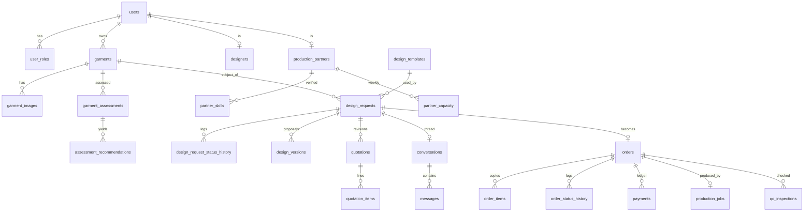

# Database (MySQL 8.0.16+ / MariaDB 10.6+)

Migrations: `database/migrations/*.sql`, applied in order by `php bin/migrate.php` (tracked in `schema_migrations`).
All tables InnoDB, utf8mb4_unicode_ci, `CHAR(36)` UUID primary keys generated in PHP, `created_at`/`updated_at`, foreign keys,
CHECK constraints and indexes on access paths. 45 tables (+ `schema_migrations`).

| File | Tables |
|---|---|
| 001_core | users, user_roles, auth_tokens, rate_limits, audit_logs |
| 002_wardrobe | garments, garment_images, garment_assessments, assessment_recommendations |
| 003_design | designers, production_partners, partner_skills, partner_capacity, design_templates, design_projects, design_requests, design_request_status_history, design_versions, design_assets, conversations, messages, request_transitions |
| 004_orders | order_transitions, quotations, quotation_items, orders, order_items, order_status_history, payments, payment_events |
| 005_operations | production_jobs, production_updates, qc_inspections, qc_checklist_items, marketplace_listings, marketplace_orders, swap_listings, swap_requests, shipments, shipment_events, support_tickets, emission_factors, activity_records, carbon_calculations, notifications |
| 006_reference_data | 9 redesign templates (reference data, not demo data) |

## Differences from the Supabase design (and why)
| Topic | Supabase version | PHP/MySQL version |
|---|---|---|
| Users | `auth.users` + `profiles` | single `users` table with bcrypt `password_hash` (PHP `password_hash`) |
| Email verification / reset | Supabase Auth | `auth_tokens` (only SHA-256 of the token stored; single use; 24 h / 1 h expiry) |
| Row-level security | Postgres RLS policies | `app/Core/Policy.php` + owner-scoped queries in services |
| Workflow RPCs | `SECURITY DEFINER` functions | service methods in a transaction with `SELECT … FOR UPDATE` |
| Files | Supabase Storage + signed URLs | `storage/uploads` outside web root + `MediaController` |
| Rate limiting | Supabase Auth built-in | `rate_limits` table (login, register, reset, resend, uploads) |
| JSON | `jsonb`, `text[]` | `JSON` columns |

## Integrity enforced by the database itself
- Append-only (UPDATE/DELETE blocked by triggers): `audit_logs`, `payments`, `payment_events`, `order_status_history`, `design_request_status_history`.
- `quotations`: amounts and request can never change; a final status (`accepted`/`rejected`/`superseded`/`expired`) cannot change. `quotation_items` cannot be updated.
- `design_requests`: insert trigger rejects a garment that does not belong to the customer.
- CHECKs: enums, money identities (`total = subtotal − discount + tax`), file size/MIME, capacity ≤ max, `carbon_calculations.is_verified = 0`.

## ERD (core slice)

